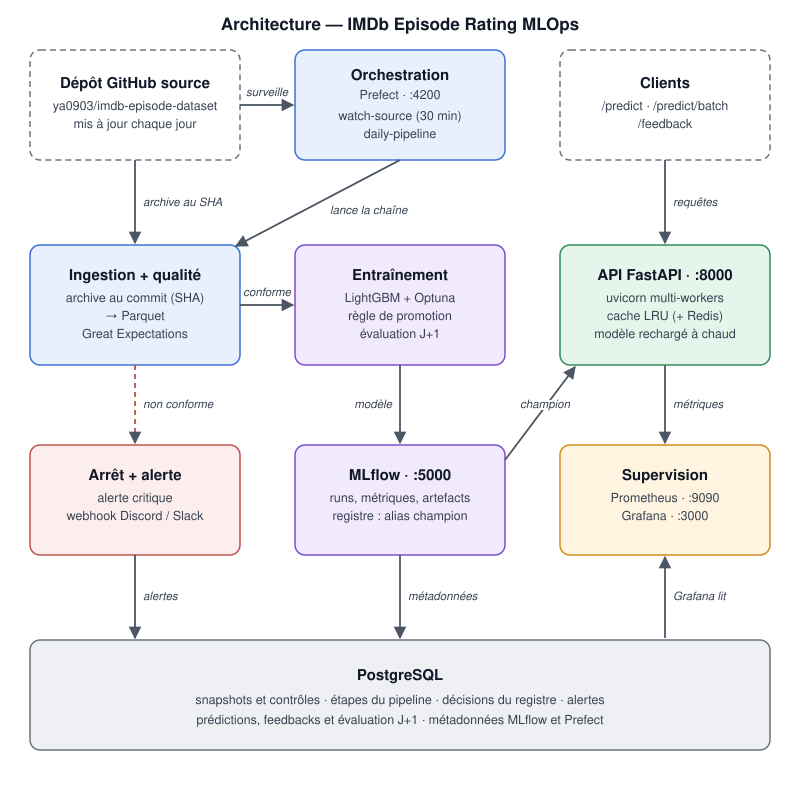

# IMDb Episode Rating — projet MLOps

Industrialisation d'un modèle simple qui **prédit la note IMDb d'un épisode de série**.
L'objectif n'est pas la performance du modèle, mais une chaîne opérationnelle complète,
reproductible et supervisée : ingestion → contrôle qualité → entraînement → registre →
API → feedback → supervision.

**Documentation** :

| Document | Contenu |
|---|---|
| Ce README | Sujet, données, stack, architecture, démarrage |
| [docs/DOCUMENTATION_TECHNIQUE.md](docs/DOCUMENTATION_TECHNIQUE.md) | Fonctionnement détaillé : données, entraînement, orchestration, API, suivi J+1, supervision, tests de charge, console de démonstration, structure du dépôt |
| [docs/DEMO.md](docs/DEMO.md) | Guide de démonstration : nominal et incidents contrôlés, avec la console ou en ligne de commande |
| [docs/SYNTHESE_OPS.md](docs/SYNTHESE_OPS.md) | Choix techniques, preuves d'intégration, tests de charge, dimensionnement, problèmes rencontrés |

**Sommaire** : [Données](#données) · [Stack technique](#stack-technique) ·
[Architecture](#architecture) · [Démarrage rapide](#démarrage-rapide) · [Services](#services)

## Données

- **Source** : [ya0903/imdb-episode-dataset](https://github.com/ya0903/imdb-episode-dataset),
  dépôt public reconstruit chaque jour par GitHub Actions à partir des
  [IMDb Non-Commercial Datasets](https://developer.imdb.com/non-commercial-datasets/)
  (`title.basics`, `title.episode`, `title.ratings`) : top 10 000 séries, épisodes à 10 votes ou plus.
- **Conditions d'utilisation** : les données IMDb sont réservées à un **usage personnel et
  non commercial**, conformément aux conditions d'IMDb. Le dépôt source ne déclare pas de
  licence propre. Ce projet est académique et non commercial, et **aucune donnée n'est
  commitée dans ce dépôt** : elles sont téléchargées à l'exécution.
- **Reproductibilité** : chaque ingestion télécharge l'archive du dépôt source **à un commit
  précis** (SHA). Ce SHA est enregistré avec chaque run d'entraînement, et le champ
  `data.pinned_sha` de [configs/config.yaml](configs/config.yaml) permet de rejouer
  exactement les mêmes données.

## Stack technique

| Besoin | Outil |
|---|---|
| Dépendances, lint, tests | uv (lockfile), ruff, pytest, pre-commit, GitHub Actions |
| Configuration | YAML (métier) + variables d'environnement `.env` (infra, secrets) |
| Qualité des données | Great Expectations |
| Orchestration | Prefect 3 |
| Suivi et registre des modèles | MLflow (métadonnées dans PostgreSQL, artefacts servis par MLflow sur un volume Docker) |
| Modèle | LightGBM + Optuna |
| API | FastAPI + cache LRU local (Redis optionnel) |
| Persistance | PostgreSQL |
| Tests de charge | Locust |
| Supervision | Prometheus (métriques et règles d'alerte) + Grafana (3 dashboards provisionnés) |

## Architecture

<p align="center">
  
</p>

**Cycle quotidien** :
1. `watch-source` détecte un nouveau commit du dépôt source, ou bien un opérateur lance
   `daily-pipeline`.
2. L'ingestion télécharge l'archive à ce commit, puis les contrôles qualité s'appliquent. En
   cas d'échec critique, la chaîne s'arrête et une alerte part.
3. L'évaluation J+1 compare les prédictions servies la veille aux notes publiées.
4. L'entraînement et la règle de promotion peuvent changer l'alias `champion`, que l'API
   recharge à chaud.
5. Chaque étape, chaque prédiction et chaque décision est tracée dans PostgreSQL et MLflow,
   et visible dans Grafana.

| Conteneur | Rôle | Limites (RAM / CPU) |
|---|---|---|
| `postgres` | bases `app` (traces), `mlflow`, `prefect` | 512 Mo |
| `mlflow` | suivi, registre, artefacts | 1 Go |
| `prefect-server` | API et UI d'orchestration | 768 Mo |
| `worker` | exécute les flows (ingestion → entraînement) | 2 Go / 10 CPU |
| `api` | service de prédiction | 2 Go / 2 CPU (paramétrable) |
| `redis` | cache partagé (désactivé par défaut) | 192 Mo |
| `prometheus`, `grafana` | supervision | 256 Mo chacun |
| `pipeline` (profil `jobs`) | commandes ponctuelles (CLI, tests, Locust) | 2 Go / 10 CPU |
| `demo-console` (profil `demo`) | console de démonstration, **présentation uniquement** | 512 Mo / 1 CPU |

## Démarrage rapide

Prérequis : Docker avec Compose v2 (environ 4 Go de RAM pour Docker), Git. Les scénarios
complets, avec ce qu'on doit observer, sont dans [docs/DEMO.md](docs/DEMO.md).

```bash
cp .env.example .env                        # puis remplacer les mots de passe « change-me »
export GIT_SHA=$(git rev-parse HEAD)        # version du code intégrée à l'image
docker compose --profile jobs build         # images (environ 5 min la 1re fois)
docker compose up -d --wait                 # 8 services
R="docker compose run --rm pipeline python -m imdb_mlops"
$R data && $R train                         # 1er snapshot, 1er modèle (6 à 14 min)
curl -s localhost:8000/predict -H 'Content-Type: application/json' \
  -d '{"series_id": "tt0903747", "season": 5, "episode": 16}'
```

Ensuite, la chaîne tourne seule : le worker Prefect surveille le dépôt source et réentraîne
à chaque nouveau commit.

**Développement local** (lint, tests unitaires, hooks) :

```bash
uv sync                       # Python 3.12 et dépendances figées (uv.lock)
uv run pre-commit install     # ruff avant chaque commit
```

> **Windows + Smart App Control** : si `.venv\Scripts\python.exe` ou une DLL est bloquée,
> recréer l'environnement avec le module venv standard
> (`"$(uv python find 3.12)" -m venv .venv && uv sync`), ou exécuter les tests dans l'image
> (`docker compose run --rm pipeline pytest`). Exporter aussi `PYTHONUTF8=1` (MLflow affiche
> des emojis que la console cp1252 ne sait pas encoder).

### Services

| Service | URL |
|---|---|
| MLflow | http://localhost:5000 |
| API (documentation interactive) | http://localhost:8000/docs |
| Prefect | http://localhost:4200 |
| Grafana (dashboards, consultation sans compte) | http://localhost:3000 |
| Prometheus (métriques, alertes) | http://localhost:9090/alerts |
| PostgreSQL | localhost:5432 (bases `mlflow`, `prefect`, `app`) |
| Redis | localhost:6379 |
| Console de démonstration (profil `demo`, présentation uniquement) | http://localhost:8080 |

Pour la suite : le fonctionnement de chaque brique est détaillé dans la
**[documentation technique](docs/DOCUMENTATION_TECHNIQUE.md)**, et la démonstration pas à pas
dans le **[guide de démonstration](docs/DEMO.md)**.
